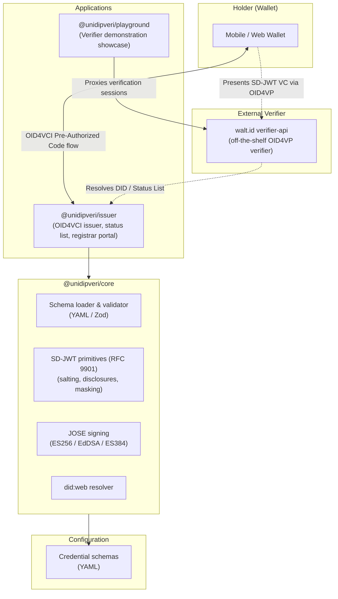

# UniDipVeri

[](https://github.com/huypengin/unidipveri/actions/workflows/ci.yaml)
[](LICENSE)
[](https://devenv.sh)
[](https://builtwithnix.org)
[](https://www.typescriptlang.org/)
[](https://bun.sh/)
[](https://datatracker.ietf.org/doc/rfc9901/)
[](https://datatracker.ietf.org/doc/draft-ietf-oauth-sd-jwt-vc/)
[](https://openid.net/specs/openid-4-verifiable-credential-issuance-1_0.html)

**UniDipVeri** is a reference implementation of an SD-JWT Verifiable Credential ecosystem for academic credentials (diplomas, transcripts, course records). It implements **IETF RFC 9901 (Selective Disclosure for JWTs)** and **draft-ietf-oauth-sd-jwt-vc-19**, issues credentials over the **OpenID4VCI Pre-Authorized Code flow (1.0 Final)**, supports revocation with an **IETF Token Status List** (`draft-ietf-oauth-status-list-21`), and demonstrates end-to-end verification through a **Playground showcase** backed by the [walt.id](https://walt.id) verifier.

> **Status: research / reference prototype, not production software.**
> It does not claim conformance with the OpenID4VC High Assurance Interoperability Profile (HAIP) or with any official conformance suite. See [Known Limitations](#known-limitations) before deploying anything.

---

## Key Features

- **Selective disclosure (RFC 9901)**: Each selectively disclosable claim gets a salt from a CSPRNG (≥ 128 bits). Hidden claims are replaced by digests in sorted `_sd` arrays, or by `{"...": "<digest>"}` markers for array elements. Digest algorithms available: SHA-256 (default), SHA-384, SHA-512.
- **SD-JWT VC profile (draft-19)**: Credentials use media type `application/dc+sd-jwt` and header `typ: "dc+sd-jwt"`, with holder binding via `cnf.jwk` and a `vct` resolved from the schema.
- **Schema-agnostic core**: No credential schema is hardcoded. Credential types are declared in YAML and validated with Zod.
- **OpenID4VCI Pre-Authorized Code flow (1.0 Final)**: Credential offers, optional transaction code (`tx_code`), token endpoint, nonce endpoint, and holder proof-of-possession verification. The Authorization Code flow is **not** implemented.
- **Revocation via Token Status List**: An RFC 1950 ZLIB-compressed bitstring served as a signed JWT (`application/statuslist+jwt`).
- **`did:web` issuer identifier**: The issuer publishes a DID document and the core resolves `did:web` identifiers and dereferences verification keys.
- **Registrar portal**: A schema-driven web form that shows each claim's disclosure policy and generates a QR code for wallets. Requires a schema to be configured via `SCHEMA_PATH`.
- **Playground showcase**: A verifier demonstration portal backed by [walt.id](https://walt.id) that lets holders present credentials from a mobile wallet and displays verified disclosures.
- **API documentation**: Swagger UI and an OpenAPI 3.0 document served by the issuer.
- **Third-party verifier interoperability**: VCs issued by UniDipVeri are verified directly by independent, off-the-shelf third-party verifiers and standard libraries.

---

## Tested Wallets

Issuance was tested by scanning a credential offer and confirming that the wallet **received and stored** the credential:

| Wallet | Version | Credential Receipt | Credential verification (walt.id) |
| :--- | :--- | :--- | :--- |
| Paradym Wallet | 1.20.2 | Yes | Yes |
| Sphereon Wallet | 0.8.0 | Yes | No (SIOPv2 `response_uri` / `client_id` mismatch) |
| Lissi ID-Wallet | 3.3.0 | Yes | No (QR code not recognized) |

Other wallets were either not tested or failed to receive the credential. Wallets that require flows this issuer does not implement (for example the Authorization Code flow) are expected to fail.

---

## Known Limitations

- **All state is in memory.** Sessions, nonces and the **revocation status list** are lost on restart, so previously revoked credentials will appear valid again after a restart.
- **The default signing key is ephemeral.** If `ISSUER_PRIVATE_KEY_JWK` is not set, a new key is generated on every boot. The DID document changes, and credentials issued before the restart will no longer verify against it.
- **No authentication on sensitive endpoints.** The registrar portal, `/credential-offer`, and `/admin/*` (including revocation) are open. Anyone who can reach the service can create offers with arbitrary claims or revoke credentials.
- **Pre-Authorized Code flow only.** The Authorization Code flow is not implemented. Wallets requiring Authorization Code flow or HAIP profile features (for example PAR/PKCE, DPoP and wallet attestation) are not supported.
- **Limited privacy.** SD-JWT hides undisclosed claims but does not provide unlinkability: the issuer signature, `cnf.jwk`, and the digests are the same in every presentation of a credential, so verifiers can correlate them. It also offers no predicate proofs (for example "over 18" without the birth date).
- **Standards are moving.** The draft references (SD-JWT VC draft-19, Token Status List draft-21) are the revisions implemented here and may have been superseded.

---

## Architecture Overview



---

## Technical Standards

| Component | Standard | Status | Scope in this project |
| :--- | :--- | :--- | :--- |
| SD-JWT | [RFC 9901](https://datatracker.ietf.org/doc/rfc9901/) | Published | Salted disclosures, nested object and array masking, reconstruction |
| SD-JWT VC | [draft-ietf-oauth-sd-jwt-vc-19](https://datatracker.ietf.org/doc/draft-ietf-oauth-sd-jwt-vc/) | Draft | `dc+sd-jwt` media type, `vct`, type metadata, `cnf` |
| Issuance | [OpenID4VCI 1.0 Final](https://openid.net/specs/openid-4-verifiable-credential-issuance-1_0.html) | Final | Pre-Authorized Code flow |
| Revocation | [draft-ietf-oauth-status-list-21](https://datatracker.ietf.org/doc/draft-ietf-oauth-status-list/) | Draft | `application/statuslist+jwt` |
| Identifiers | [W3C DID Core](https://www.w3.org/TR/did-core/) with `did:web` | Recommendation | Publication and resolution over HTTPS |
| JOSE | RFC 7515, 7517, 7518 | IETF Standards | `ES256`, `EdDSA`, `ES384` |

Not implemented: OpenID4VP (presentation protocol — delegated to walt.id), Authorization Code flow, DPoP, wallet/key attestation.

---

## Monorepo Structure

```
unidipveri/
├── apps/
│   ├── issuer/          # OID4VCI issuer, status list, registrar portal (@unidipveri/issuer)
│   │   ├── src/
│   │   │   ├── config.ts      # Zod environment configuration
│   │   │   ├── services/      # KeyManager, SessionManager, StudentRecords, StatusList
│   │   │   ├── routes/        # Discovery, DID doc, VCT metadata, Offer, Token, Credential, Portal, Docs
│   │   │   ├── app.ts         # HTTP request dispatcher and CORS
│   │   │   └── server.ts      # Bun.serve entrypoint
│   │   └── tests/
│   └── playground/      # Verifier demonstration showcase backed by walt.id (@unidipveri/playground)
│       ├── src/
│       └── tests/
├── packages/
│   └── core/            # Schema-agnostic SD-JWT VC engine (@unidipveri/core)
│       ├── src/         # schema/, sd-jwt/, signing/, did/, config/
│       └── tests/
├── schemas/             # YAML credential schemas (graduation-record.v1.yaml is the default)
├── devenv.nix           # Nix-based dev environment (provisions all services)
├── docker-compose.yml   # walt.id verifier container
├── package.json         # Bun workspaces: ["packages/*", "apps/*"]
└── tsconfig.json        # Shared: ESNext, Bundler resolution, strict
```

---

## Packages & Applications

### `@unidipveri/core`
The cryptographic and data-model engine. It keeps no global state and takes schemas, keys and configuration as arguments. Its only I/O is loading a schema file and `did:web` resolution over HTTP.
- **Salting**: ≥ 128-bit CSPRNG salts via Web Crypto.
- **Claim masking**: Turns nested JSON claims into masked payloads with sorted `_sd` arrays and `...` element markers, and reconstructs claims from presented disclosures.
- **Signing**: Signs the outer JWS (`typ: "dc+sd-jwt"`) and verifies signatures.
- **Resolver**: `did:web` resolution and verification-key dereferencing.

[Core documentation](packages/core/README.md)

### `@unidipveri/issuer`
The issuance service:
- **Discovery**: `/.well-known/openid-credential-issuer`, `/.well-known/oauth-authorization-server`, `/.well-known/did.json`, `/.well-known/jwt-vc-issuer`.
- **OID4VCI issuance**: Pre-authorized code, optional `tx_code`, proof-of-possession verification, and key binding into `cnf.jwk`.
- **Revocation**: Token Status List endpoint plus **unauthenticated** admin endpoints to revoke.
- **Registrar portal**: Schema-driven form and disclosure-policy badges.
- **Docs**: Swagger UI at `/docs`.

[Issuer documentation](apps/issuer/README.md)

### `@unidipveri/playground`
A verifier demonstration showcase that proxies [walt.id](https://walt.id)'s off-the-shelf OID4VP verifier:
- Generates OpenID4VP authorization requests as scannable QR codes.
- Polls verification session status and displays disclosed claims, policy results, and audit trails.
- Persists verification evidence (JSON logs) for offline review.

[Playground documentation](apps/playground/README.md)

---

## Getting Started

### Prerequisites

| Dependency | Required for | Install |
| :--- | :--- | :--- |
| **[devenv](https://devenv.sh/) / Nix** | Recommended path — provisions Bun, Cloudflare tunnels, and all services | [devenv.sh/getting-started](https://devenv.sh/getting-started/) |
| **[Bun](https://bun.sh/)** (≥ 1.1) | Manual path — running the issuer and playground directly | [bun.sh](https://bun.sh/) |
| **Docker or Podman** | Manual path — running the walt.id verifier container | [docker.com](https://docs.docker.com/get-docker/) or [podman.io](https://podman.io/getting-started/installation) |

### Clone and Install

```bash
git clone https://github.com/huypengin/unidipveri.git
cd unidipveri
bun install --frozen-lockfile
```

### Option A: `devenv up` (Recommended)

One command provisions everything: the issuer with a Cloudflare tunnel, the walt.id verifier container, and the playground showcase. Mobile wallets can reach the issuer over HTTPS immediately.

```bash
devenv up
```

`devenv up` starts five coordinated processes:

| Service | Local address | What it does |
| :--- | :--- | :--- |
| **Issuer** | `http://localhost:3000` | OID4VCI issuer, registrar portal, Swagger UI |
| **Issuer tunnel** | `https://<random>.trycloudflare.com` | Public HTTPS for mobile wallets |
| **walt.id verifier** | `http://localhost:7004` | Off-the-shelf OID4VP verifier (container) |
| **Verifier tunnel** | `https://<random>.trycloudflare.com` | Public HTTPS for cross-device presentation |
| **Playground** | `http://localhost:3001` | Verifier demonstration showcase UI |

Environment variables (`ISSUER_BASE_URL`, `ISSUER_DID`, `VCT_BASE_URL`, `VERIFIER_PUBLIC_URL`) are auto-configured from the tunnel URLs. No manual setup needed.

**Quick workflow after `devenv up`:**

1. Open the **Registrar Portal** at `http://localhost:3000` — fill in student data and generate a credential offer QR code.
2. Scan the QR with a compatible wallet (Paradym, Sphereon, or Lissi) to receive the SD-JWT VC.
3. Open the **Playground** at `http://localhost:3001` — scan the verification QR with the same wallet to present the credential.
4. View the disclosed claims, policy results, and audit trail in the Playground UI.

### Option B: Manual (Bun + Container)

Use this if you cannot or prefer not to install Nix/devenv.

#### 1. Start the Issuer

```bash
export SCHEMA_PATH="$(pwd)/schemas/graduation-record.v1.yaml"
export ISSUER_BASE_URL="http://localhost:3000"
export ISSUER_DID="did:web:localhost%3A3000"

bun run dev:issuer
```

> **Note:** Plain HTTP on localhost is sufficient for local development and testing. Mobile wallets generally require a public HTTPS URL — use a reverse proxy or tunnel (e.g. `cloudflared tunnel --url http://localhost:3000`) to expose the issuer.

#### 2. Start the walt.id Verifier

```bash
docker compose up        # or: podman-compose up
```

This starts the walt.id verifier API on `http://localhost:7004` using the pinned image in [`docker-compose.yml`](docker-compose.yml).

#### 3. Start the Playground

```bash
export WALTID_BASE="http://localhost:7004"
export ISSUER_BASE_URL="http://localhost:3000"    # or your tunnel URL
export VERIFIER_PUBLIC_URL="http://localhost:7004" # or your tunnel URL

bun run dev:playground
```

The playground UI is available at `http://localhost:3001`.

> **Important:** For cross-device wallet presentation (scanning QR codes from a phone), both the issuer and the verifier need public HTTPS URLs. Set `ISSUER_BASE_URL` and `VERIFIER_PUBLIC_URL` to your tunnel hostnames.

---

## Running Tests

The test suites verify behavioral correctness across schema validation, cryptographic primitives (salting, disclosures, digests), claim masking and reconstruction, signature generation and verification for all supported algorithms (`ES256`, `EdDSA`, `ES384`), OID4VCI protocol flows (credential offers, token exchange, nonce management, proof-of-possession), revocation via Token Status List, `did:web` resolution, issuer discovery endpoints, and security edge cases.

> **Note:** The issuer test suite includes a smoke check against `@sd-jwt/sd-jwt-vc` (pinned in `devDependencies`). This is strictly a development regression check for wire serialization; it is **not** counted as independent third-party interoperability evidence. 

```bash
bun run test        # all workspaces
bun run typecheck   # strict TypeScript checks

# Per-package
cd packages/core && bun test
cd apps/issuer && bun test
cd apps/playground && bun test
```

---

## Configuration Reference

Environment variables, validated with Zod at startup:

| Variable | Description | Default | Required |
| :--- | :--- | :--- | :--- |
| `SCHEMA_PATH` | Path to the credential schema YAML | none | **Yes** |
| `SIGNING_ALGORITHM` | `ES256`, `EdDSA`, or `ES384` | `ES256` | No |
| `KEY_ID` | Key identifier in the DID document and JWKS | `key-1` | No |
| `ISSUER_IDENTIFIER_MODE` | Issuer identifier format: `did` (Variant A, `did:web`) or `https` (Variant B, HTTPS URL with `/.well-known/jwt-vc-issuer`) | `did` | No |
| `ISSUER_DID` | Issuer DID (must start with `did:`) | `did:web:localhost%3A3000` | No |
| `ISSUER_BASE_URL` | Public base URL of the issuer (use HTTPS outside local development) | `http://localhost:3000` | No |
| `VCT_BASE_URL` | Base URL used to resolve a relative `vctPath` | `ISSUER_BASE_URL` | No |
| `PORT` / `ISSUER_PORT` | HTTP listener port | `3000` | No |
| `ISSUER_HOST` | Bind address | `0.0.0.0` | No |
| `ISSUER_PRIVATE_KEY_JWK` | Private signing key as a JWK JSON string | **Ephemeral key generated on every boot** | No (strongly recommended) |

> **Warning:** Without `ISSUER_PRIVATE_KEY_JWK`, every restart changes the issuer key and invalidates verification of earlier credentials. Revocation state is also lost on restart.

---

## Credential Schema Definition

Schemas are YAML files validated against strict structural rules:

```yaml
vctPath: "/types/graduation-record/v1"
name: "Graduation Academic Record"
description: "Official university graduation record and transcript."

claims:
  studentId:
    type: string
    required: true
    sd: always_disclosed
    description: "Internal university student identifier"

  dateOfBirth:
    type: string
    format: date
    required: false
    sd: selectively_disclosable
    description: "Date of birth (YYYY-MM-DD)"

  papers:
    type: object
    required: true
    sd: always_disclosed
    properties:
      diploma:
        type: object
        required: true
        sd: selectively_disclosable
        properties:
          degreeName:
            type: string
            required: true
            sd: always_disclosed
          graduationDate:
            type: string
            format: date
            required: true
            sd: always_disclosed
```

### Selective Disclosure Rules
- `always_disclosed`: the claim is placed directly in the signed JWT payload.
- `selectively_disclosable`: the claim is paired with a ≥ 128-bit salt, encoded as a Base64URL disclosure (`[salt, claimName, claimValue]`), hashed (default `sha-256`), and replaced by its digest in the `_sd` array.
- **Nesting**: `always_disclosed` applies *within* its parent. In the example, `degreeName` and `graduationDate` are always disclosed relative to `diploma`, but they are only visible to a verifier when `diploma` itself is disclosed, because the whole `diploma` object sits behind a digest.
- **Arrays**: selectively disclosable array elements are replaced by `{"...": "<digest>"}` markers.

---

## Deployment Notes

UniDipVeri is a reference implementation. Before any real deployment:

- **State persistence**: Sessions, nonces and the revocation bitstring are in memory. Use a persistent, shared store (for example PostgreSQL or Redis); otherwise restarts reset revocation.
- **Key management**: Load keys from a KMS/HSM (AWS KMS, GCP Cloud KMS, Azure Key Vault, HashiCorp Vault) rather than environment variables or ephemeral memory.
- **Access control**: Protect the portal, `/credential-offer` and `/admin/*` with institutional SSO (SAML 2.0 / OIDC) and RBAC.
- **Traffic protection**: Add rate limiting and a WAF, and serve status lists (`/status/:id`) behind a CDN with sensible cache invalidation.
- **Interoperability profile**: If HAIP conformance is a requirement, additional work is needed (see [Known Limitations](#known-limitations)).

---

## License

This project is licensed under the MIT License - see the [LICENSE](LICENSE) file for details.
