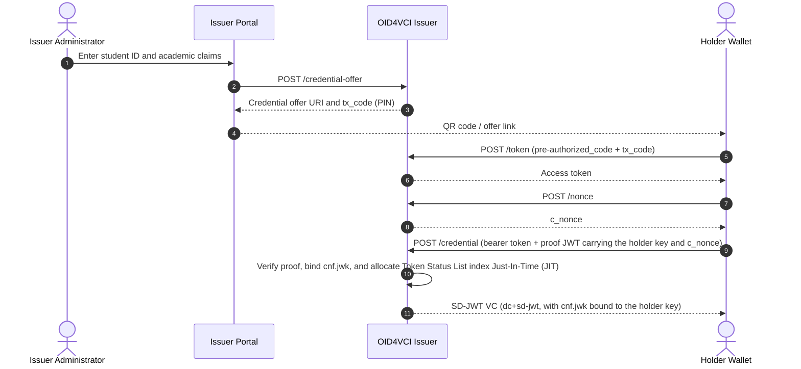

# @unidipveri/issuer

[](https://www.typescriptlang.org/)
[](https://openid.net/specs/openid-4-verifiable-credential-issuance-1_0.html)
[](https://datatracker.ietf.org/doc/draft-ietf-oauth-status-list/)

`@unidipveri/issuer` is a reference **credential issuer** that implements the **OpenID4VCI Pre-Authorized Code flow (1.0 Final)**, with an interactive issuer web portal and an **IETF Token Status List** revocation endpoint.

> **Prototype, not production software.** All state is held in memory, the default signing key is ephemeral, and the portal, `/credential-offer` and `/admin/*` endpoints have **no authentication**. See [Known Limitations](#known-limitations).

**Not implemented:** Authorization Code flow, DPoP, wallet/key attestation, OpenID4VP.

**Tested wallets** (received and stored the VC): Paradym Wallet, Sphereon Wallet, Lissi ID-Wallet. Other wallets were not tested or failed to receive the credential.

---

## Issuance Flow



---

## Endpoints

### Discovery and Public Metadata
| Method | Path | Content-Type | Description |
| :--- | :--- | :--- | :--- |
| `GET` | `/.well-known/openid-credential-issuer` | `application/json` | Issuer metadata (`credential_configurations_supported`, endpoints, display). |
| `GET` | `/.well-known/oauth-authorization-server` | `application/json` | Authorization server metadata (token endpoint, grant types). |
| `GET` | `/.well-known/openid-configuration` | `application/json` | Alias for the authorization server metadata. |
| `GET` | `/.well-known/did.json` | `application/did+ld+json` | DID document with the issuer's active verification key (Variant A). |
| `GET` | `/.well-known/jwt-vc-issuer` | `application/json` | SD-JWT VC Issuer Metadata Document with inline JWKS (Variant B). |
| `GET` | `/types/*` | `application/json` | SD-JWT VC type metadata (JSON Schema and claim display definitions). |

### Issuance (OpenID4VCI, Pre-Authorized Code flow)
| Method | Path | Auth | Description |
| :--- | :--- | :--- | :--- |
| `GET`/`POST` | `/credential-offer` | **None** | Creates a credential offer tied to a pre-authorized code session, with optional `tx_code` and custom claim values. |
| `POST` | `/batch/offers` | **None** | Ingests CSV or JSON batch records, validates against YAML schema, creates pre-authorized sessions, and returns batch metadata with ZIP download link. |
| `GET` | `/batch/download/:batchId` | None | Downloads the in-memory ZIP package containing `manifest.json`, `offers.csv`, and pre-rendered QR code PNGs. |
| `POST` | `/token` | Pre-authorized code (+ `tx_code`) | Exchanges `urn:ietf:params:oauth:grant-type:pre-authorized_code` for an access token. |
| `POST` | `/nonce` | None | Returns a fresh `c_nonce` for the holder proof. |
| `POST` | `/credential` | Bearer token | Verifies holder proof JWT and nonce, binds `cnf.jwk`, allocates status index JIT, and issues the SD-JWT VC. |

### Revocation (Token Status List)
| Method | Path | Auth | Description |
| :--- | :--- | :--- | :--- |
| `GET` | `/status/:id` | None | Signed Token Status List JWT (`application/statuslist+jwt`) containing an RFC 1950 ZLIB-compressed bitstring. |
| `POST` | `/status/revoke` or `/admin/revoke` | **None** | Marks a credential as revoked, targeting either numeric `index` or institutional `subjectId` / `studentId`. |
| `GET` | `/admin/status/:idx` | **None** | Returns the revocation state for an index. |
| `GET` | `/status/subject/:subjectId` | **None** | Returns the allocated index and revocation state for a student ID. |

### Interface and Documentation
| Method | Path | Description |
| :--- | :--- | :--- |
| `GET` | `/single-issue` | Schema-driven interactive single credential form and QR generation. |
| `GET`/`POST` | `/batch-issue` | Cohort CSV batch upload (10 MB request limit), schema pre-validation, and ZIP distribution package generator. |
| `GET` | `/style.css` | Dedicated shared stylesheet for issuer web interfaces. |
| `GET` | `/docs` or `/swagger` | Swagger UI. |
| `GET` | `/docs/openapi.json` | OpenAPI 3.0 document. |
| `GET` | `/health` | Health status and uptime. |

---

## Issuer Portal

Configured dynamically by `SCHEMA_PATH`:

### 1. Single Credential Form (`/single-issue`)
- **Schema-driven inputs**: Form dynamically renders appropriate controls (`string`, `number`, `boolean`, `date`, `object`, dynamic `array` tables) based on the YAML schema.
- **Readable labels**: CamelCase property names become formatted labels (`gradeIn4.0` → `Grade In 4.0`).
- **Disclosure badges**: Visual indicators showing `Always Disclosed` (in clear) or `Selectively Disclosable` (salted `_sd` digest).
- **Instant QR**: Generates scannable `openid-credential-offer://` QR codes for in-person testing.

### 2. Cohort Batch Portal (`/batch-issue`)
- **CSV Ingestion**: Upload tabular spreadsheets with column headers matching schema paths (e.g. `studentId`, `papers.diploma.degreeName`), enforced with a 10 MB request size limit (`MAX_BATCH_REQUEST_SIZE_BYTES`) and stream-limiting protection against memory exhaustion.
- **Pre-Validation**: Highlights schema discrepancies and type errors before session generation.
- **ZIP Download**: Assembles an in-memory ZIP package (`batch-<id>.zip`) containing:
  - `manifest.json`: Full batch metadata and deep links.
  - `offers.csv`: Tabular student-to-offer mapping for university distribution.
  - `qr-codes/<studentId>_offer.png`: Pre-rendered high-resolution QR codes.
- **JIT Allocation Assurance**: Status list bits are not consumed until students claim their credentials, preventing orphaned bit allocations.
- **Student ID Revocation**: Issuer administrators can revoke degrees by Student ID directly via the portal or API.

---

## Configuration Reference

Environment variables, validated with Zod:

| Variable | Description | Default |
| :--- | :--- | :--- |
| `SCHEMA_PATH` | Path to the credential YAML schema | *(required)* |
| `ISSUER_BASE_URL` | Public base URL of the service (HTTPS outside local development) | `http://localhost:3000` |
| `ISSUER_IDENTIFIER_MODE` | Issuer identifier format: `did` (Variant A, `did:web`) or `https` (Variant B, HTTPS URL) | `did` |
| `VCT_BASE_URL` | Base URL used to construct canonical VCT URIs | `ISSUER_BASE_URL` |
| `ISSUER_DID` | Issuer DID (`did:web:...`) | `did:web:localhost%3A3000` |
| `SIGNING_ALGORITHM` | `ES256`, `EdDSA` or `ES384` | `ES256` |
| `KEY_ID` | Key identifier in the DID document | `key-1` |
| `PORT` | HTTP listener port | `3000` |
| `ISSUER_HOST` | Bind address | `0.0.0.0` |
| `ISSUER_PRIVATE_KEY_JWK` | Private signing key as a JWK JSON string | **Ephemeral key, regenerated on every boot** |
| `STATUS_LIST_PATH` | File path for persisting Token Status List state across server restarts | *(in-memory if omitted)* |
| `STATUS_LIST_TTL_SECONDS` | Token Status List cache duration in seconds (`ttl` claim and Cache-Control max-age). Set to `0` to disable caching (`no-cache, no-store`) | `300` |
| `ENABLE_LEGACY_VC_FORMAT` | Flag controlling whether legacy `vc+sd-jwt` format is offered and issued (`true` or `false`) | `false` |

> **Warning:** If `ISSUER_PRIVATE_KEY_JWK` is omitted, each restart generates a new key. The DID document changes and credentials issued earlier will no longer verify against it. Plain HTTP defaults are for local development only; wallets generally require a public HTTPS URL.
>
> Use the keygen helper to generate a persistent private key:
> ```bash
> bun run keygen                     # Generate default ES256 keypair with export snippet
> bun run keygen EdDSA               # Generate EdDSA (Ed25519) keypair
> eval $(bun run keygen --env)       # Export directly into current environment
> ```

---

## Development and Testing

```bash
# Watch mode
bun run dev

# Run tests
bun test
```

The test suite covers the OID4VCI protocol flow (credential offers, token exchange with pre-authorized codes, nonce lifecycle, holder proof-of-possession verification), credential issuance with selective disclosure and holder key binding, Token Status List revocation and status queries, issuer discovery and metadata endpoints (OpenID, DID document, JWT-VC issuer, VCT type metadata), the issuer portal UI and schema-driven form generation, OpenAPI specification and Swagger UI, application routing, CORS handling, error responses, and security edge cases (malformed inputs, replay protection, timing-safe comparisons).

The tests exercise the implemented behavior. They are not an official OpenID conformance suite. The test suite includes an off-the-shelf library smoke check (`@sd-jwt/sd-jwt-vc` pinned in `devDependencies`) which serves strictly as a development regression test to verify wire output; it is **not** counted as independent third-party interoperability evidence.

---

## Known Limitations

1. **In-memory defaults.** By default, sessions and `c_nonce` values are held in memory. The Token Status List is also in-memory unless `STATUS_LIST_PATH` is configured to persist bitstring state across server restarts.
2. **Ephemeral signing key by default.** See the warning in Configuration. Set `ISSUER_PRIVATE_KEY_JWK` to keep the same key across restarts.
3. **No authentication** on the issuer portal, `/credential-offer` (which accepts custom claims, and also via `GET`) and `/admin/*`. Anyone who can reach the service can mint offers with arbitrary claims or revoke credentials.
4. **Key storage.** Keys live in application memory or an environment variable. Production use needs an HSM (PKCS#11) or cloud KMS (AWS KMS, GCP Cloud KMS, Azure Key Vault).
5. **Rate limiting and caching.** `/token`, `/credential` and `/nonce` need rate limiting; `/status/:id` cache duration is configurable via `STATUS_LIST_TTL_SECONDS` (defaults to 300 seconds; set to 0 for no-cache) and should be served behind a CDN with suitable cache invalidation.
6. **Scope.** Only the Pre-Authorized Code flow is supported, so wallets that need other flows will fail against this issuer. Not HAIP-conformant.
7. **No automated inbound SIS webhook adapter.** The issuer currently accepts credential offer requests via direct REST (`POST /credential-offer`) and the interactive issuer portal. Automated webhook ingestion from enterprise Student Information Systems (e.g. Banner, PeopleSoft, SAP Campus) is not yet implemented.

Production deployment would additionally require a persistent session/nonce/status store (PostgreSQL or Redis), institutional SSO (SAML 2.0 / OIDC) with RBAC, and a security review.
