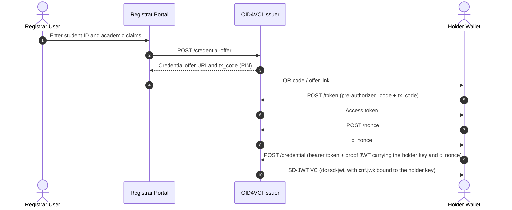

# @unidipveri/issuer

[](https://www.typescriptlang.org/)
[](https://openid.net/specs/openid-4-verifiable-credential-issuance-1_0.html)
[](https://datatracker.ietf.org/doc/draft-ietf-oauth-status-list/)

`@unidipveri/issuer` is a reference **credential issuer** that implements the **Pre-Authorized Code flow of OpenID4VCI 1.0 Final**, with an interactive registrar web portal and an **IETF Token Status List** revocation endpoint.

> **Prototype, not production software.** All state is held in memory, the default signing key is ephemeral, and the portal, `/credential-offer` and `/admin/*` endpoints have **no authentication**. See [Known Limitations](#known-limitations).

**Not implemented:** Authorization Code flow, DPoP, wallet/key attestation, OpenID4VP.

**Tested wallets** (received and stored the VC): Paradym Wallet, Sphereon Wallet, Lissi ID-Wallet. Other wallets were not tested or failed to receive the credential.

---

## Issuance Flow



---

## Endpoints

### Discovery and Public Metadata
| Method | Path | Content-Type | Description |
| :--- | :--- | :--- | :--- |
| `GET` | `/.well-known/openid-credential-issuer` | `application/json` | Issuer metadata (`credential_configurations_supported`, endpoints, display). |
| `GET` | `/.well-known/oauth-authorization-server` | `application/json` | Authorization server metadata (token endpoint, grant types). |
| `GET` | `/.well-known/openid-configuration` | `application/json` | Alias for the authorization server metadata. |
| `GET` | `/.well-known/did.json` | `application/did+ld+json` | DID document with the issuer's active verification key. |
| `GET` | `/types/*` | `application/json` | SD-JWT VC type metadata (JSON Schema and claim display definitions). |

### Issuance (OpenID4VCI, Pre-Authorized Code flow)
| Method | Path | Auth | Description |
| :--- | :--- | :--- | :--- |
| `GET`/`POST` | `/credential-offer` | **None** | Creates a credential offer tied to a pre-authorized code session, with optional `tx_code` and custom claim values. |
| `POST` | `/token` | Pre-authorized code (+ `tx_code`) | Exchanges `urn:ietf:params:oauth:grant-type:pre-authorized_code` for an access token. |
| `POST` | `/nonce` | None | Returns a fresh `c_nonce` for the holder proof. |
| `POST` | `/credential` | Bearer token | Verifies the holder proof JWT and nonce, then issues the SD-JWT VC. |

### Revocation (Token Status List)
| Method | Path | Auth | Description |
| :--- | :--- | :--- | :--- |
| `GET` | `/status/:id` | None | Signed Token Status List JWT (`application/statuslist+jwt`) containing a Gzip-compressed bitstring. |
| `POST` | `/admin/revoke` | **None** | Marks a credential index as revoked. |
| `GET` | `/admin/status/:idx` | **None** | Returns the revocation state for an index. |

### Interface and Documentation
| Method | Path | Description |
| :--- | :--- | :--- |
| `GET` | `/` or `/issue` | Registrar portal (claim entry, schema inspection, QR generation). **Unauthenticated.** |
| `GET` | `/docs` or `/swagger` | Swagger UI. |
| `GET` | `/docs/openapi.json` | OpenAPI 3.0 document. |
| `GET` | `/health` | Health status and uptime. |

---

## Registrar Portal

Available at `/`, configured by the schema in `SCHEMA_PATH`:
- **Schema-driven form**: Inputs adapt to the loaded YAML schema (`string`, `number`, `boolean`, `date`, `object`, and dynamic `array` tables).
- **Readable labels**: CamelCase and alphanumeric property names become labels (for example `gradeIn4.0` → `Grade In 4.0`).
- **Disclosure policy badges**: `Always Disclosed` for claims in the clear, `Selectively Disclosable` for claims behind an `_sd` digest.
- **QR code issuance**: Encodes the credential offer as an `openid-credential-offer://` URI (the scheme defined by the OpenID4VCI specification) for wallets to scan.

---

## Configuration Reference

Environment variables, validated with Zod:

| Variable | Description | Default |
| :--- | :--- | :--- |
| `SCHEMA_PATH` | Path to the credential YAML schema | *(required)* |
| `ISSUER_BASE_URL` | Public base URL of the service (HTTPS outside local development) | `http://localhost:3000` |
| `VCT_BASE_URL` | Base URL used to construct canonical VCT URIs | `ISSUER_BASE_URL` |
| `ISSUER_DID` | Issuer DID (`did:web:...`) | `did:web:localhost%3A3000` |
| `SIGNING_ALGORITHM` | `ES256`, `EdDSA` or `ES384` | `ES256` |
| `KEY_ID` | Key identifier in the DID document | `key-1` |
| `PORT` | HTTP listener port | `3000` |
| `ISSUER_HOST` | Bind address | `0.0.0.0` |
| `ISSUER_PRIVATE_KEY_JWK` | Private signing key as a JWK JSON string | **Ephemeral key, regenerated on every boot** |

> **Warning:** If `ISSUER_PRIVATE_KEY_JWK` is omitted, each restart generates a new key. The DID document changes and credentials issued earlier will no longer verify against it. Plain HTTP defaults are for local development only; wallets generally require a public HTTPS URL.

---

## Development and Testing

```bash
# Watch mode
bun run dev

# 171 automated tests covering the offer, token, nonce, credential and revocation endpoints
bun test
```

The tests exercise the implemented behavior. They are not an official OpenID conformance suite.

---

## Known Limitations

1. **Everything is in memory.** Sessions, `c_nonce` values and the **revocation status list** (`SessionManager`, `StatusList`) are lost on restart. After a restart, previously revoked credentials appear valid again.
2. **Ephemeral signing key by default.** See the warning in Configuration. Set `ISSUER_PRIVATE_KEY_JWK` to keep the same key across restarts.
3. **No authentication** on the registrar portal, `/credential-offer` (which accepts custom claims, and also via `GET`) and `/admin/*`. Anyone who can reach the service can mint offers with arbitrary claims or revoke credentials.
4. **Key storage.** Keys live in application memory or an environment variable. Production use needs an HSM (PKCS#11) or cloud KMS (AWS KMS, GCP Cloud KMS, Azure Key Vault).
5. **Rate limiting and caching.** `/token`, `/credential` and `/nonce` need rate limiting; `/status/:id` should be served behind a CDN with suitable cache invalidation.
6. **Scope.** Only the Pre-Authorized Code flow is supported, so wallets that need other flows will fail against this issuer. Not HAIP-conformant.

Production deployment would additionally require a persistent session/nonce/status store (PostgreSQL or Redis), institutional SSO (SAML 2.0 / OIDC) with RBAC, and a security review.
