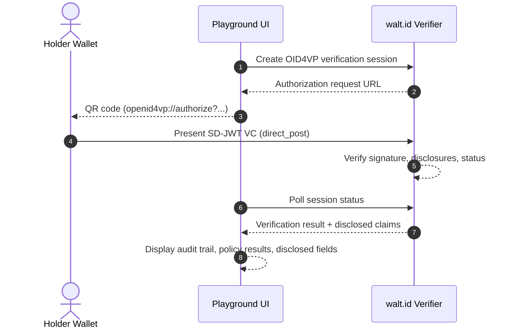

# @unidipveri/playground

`@unidipveri/playground` is a **verifier demonstration showcase** that provides a web UI for presenting and verifying SD-JWT VCs issued by the UniDipVeri issuer. It delegates credential verification to the [walt.id](https://walt.id) off-the-shelf OID4VP verifier and displays the results in a human-readable format.

> **Prototype, not production software.** This service is intended for demonstrations and thesis evaluation, not real-world relying-party use.

---

## How It Works



---

## Features

- **QR-based verification**: Generates OpenID4VP authorization requests as scannable QR codes for cross-device wallet presentation.
- **Real-time status polling**: Monitors the walt.id verification session and updates the UI when the wallet responds.
- **Audit trail**: Displays disclosed claims, policy evaluation results (signature validity, credential status), and raw verification data.
- **Evidence persistence**: Saves complete verification session data (JSON) to disk for offline review and thesis documentation.
- **Tunnel-aware**: Auto-discovers Cloudflare Quick Tunnel URLs from devenv logs, rewriting internal `localhost` references to public HTTPS URLs in authorization requests.

---

## Configuration

Environment variables:

| Variable | Description | Default |
| :--- | :--- | :--- |
| `PORT` / `PORTAL_PORT` | HTTP listener port | `3001` |
| `WALTID_BASE` | walt.id verifier API base URL | `http://localhost:7004` |
| `VERIFIER_PUBLIC_URL` | Public URL of the verifier (for QR codes) | Auto-discovered from tunnel logs, or `WALTID_BASE` |
| `ISSUER_BASE_URL` | Issuer public URL (for VCT resolution in queries) | Auto-discovered from tunnel logs |
| `VCT_TYPE` | Credential type name for DCQL queries | `graduation-record` |
| `VCT_VERSION` | Credential type version | `v1` |

When running via `devenv up`, all variables are configured automatically.

---

## Running

### Via devenv (recommended)

The playground starts automatically as part of `devenv up` — see the [root README](../../README.md#getting-started).

### Standalone

Requires the walt.id verifier to be running (see [`docker-compose.yml`](../../docker-compose.yml)):

```bash
docker compose up -d               # start walt.id verifier on :7004

export WALTID_BASE="http://localhost:7004"
export ISSUER_BASE_URL="http://localhost:3000"
export VERIFIER_PUBLIC_URL="http://localhost:7004"

bun run dev
```

The UI is available at `http://localhost:3001`.

> **Note:** For cross-device presentation (scanning QR codes from a phone), both the issuer and verifier need public HTTPS URLs. See the root README for tunnel setup instructions.

---

## Endpoints

| Method | Path | Description |
| :--- | :--- | :--- |
| `GET` | `/` | Playground UI — creates a verification session and renders a QR code |
| `POST` | `/api/session` | Creates a new walt.id verification session (JSON API) |
| `GET` | `/api/status?sessionId=...` | Polls session status and returns verification results |
| `GET` | `/health` | Health check with configuration summary |

---

## Testing

The test suite covers configuration loading and environment variable resolution, OID4VP authorization URL rewriting (internal-to-public URL translation for tunnel scenarios), verification session evidence persistence and file I/O, and audit data extraction and formatting.

```bash
bun test
```
