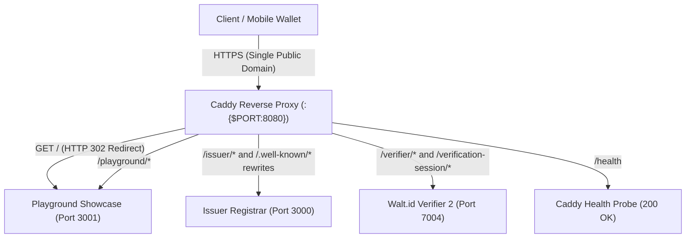

# UniDipVeri Showcase Cloud Deployment (Render)

This directory provides the production deployment artifacts to run UniDipVeri as a unified, single-container public showcase on [Render](https://render.com) (or any Docker-compatible container hosting platform).

---

## Architecture Overview

Render provides a single public web service domain (e.g. `https://unidipveri-demo.onrender.com`) and routes incoming external traffic to an assigned dynamic `$PORT`.

To host the full ecosystem (Issuer, Verifier Showcase, and off-the-shelf Walt.id Verifier) under this single hostname without altering application logic, an internal Caddy reverse proxy acts as the container front door:



### Components

| Component | Internal Port | Description |
| :--- | :--- | :--- |
| **Caddy Gateway** | `:{$PORT:8080}` | Reverse proxy managing path routing, well-known rewrites, and health checks |
| **UniDipVeri Issuer** | `127.0.0.1:3000` | OID4VCI credential issuer, registrar portal, and DID document |
| **UniDipVeri Playground** | `127.0.0.1:3001` | Interactive verifier demonstration showcase UI |
| **Walt.id Verifier 2** | `127.0.0.1:7004` | Off-the-shelf OID4VP verifier engine (JVM runtime) |

### Path Routing and Protocol Compatibility

- **`GET /`**: Redirects (HTTP 302) to `/playground/` (interactive showcase UI).
- **`/issuer/*`**: Proxies to UniDipVeri Issuer on port 3000 (trailing slash normalized via HTTP 308).
- **`/playground/*`**: Proxies to UniDipVeri Playground on port 3001.
- **`/verifier/*`**: Proxies to Walt.id Verifier on port 7004.
- **RFC 8414 & OID4VCI Path Insertion**: Mobile wallets (such as Paradym) query `/.well-known/openid-credential-issuer/issuer` when issuers reside at subpaths; Caddy rewrites this to `/.well-known/openid-credential-issuer` and routes to the Issuer.
- **W3C `did:web` Resolution**: `did:web:<domain>:issuer` queries `https://<domain>/issuer/did.json`, which Caddy rewrites to `/.well-known/did.json`.
- **Health Probe (`/health`)**: Caddy directly responds with HTTP 200 OK for platform liveness checks.

---

## Key Custody and Persistent Identity

To ensure that credentials issued across different demonstration sessions verify consistently against the issuer DID document:

1. **Generate a Demo Keypair Locally**:
   ```bash
   bun run keygen --json
   ```
2. **Configure in Render**:
   - In the Render Dashboard, navigate to **Environment** settings for the web service.
   - Add `ISSUER_PRIVATE_KEY_JWK` and paste the compact JSON string.
   - **Security Invariant**: Never commit `ISSUER_PRIVATE_KEY_JWK` to git, build arguments, or container images.
3. **Ephemeral Fallback**:
   - If `ISSUER_PRIVATE_KEY_JWK` is omitted, the supervisor entrypoint (`deploy/entrypoint.sh`) generates an ephemeral keypair at startup and logs a prominent warning.

---

## Known Demonstration Limitations on Render Free Tier

1. **Ephemeral Status List & Session Reset**:
   - On the Render free tier, web services spin down after 15 minutes of inactivity and restart on a fresh ephemeral filesystem without persistent disk storage.
   - The Token Status List is located at `STATUS_LIST_PATH="/tmp/status-list.json"`.
   - **Impact**: While setting `ISSUER_PRIVATE_KEY_JWK` ensures that previously issued credentials verify cryptographically against the DID document across restarts, revocation states and active sessions reset upon container restart or idle spin-down. Credentials issued in earlier sessions will no longer reflect updated revocation states.
2. **Cold Start Latency**:
   - Free-tier services take 30 to 60 seconds to spin up from an idle state upon receiving the first incoming HTTP request.

---

## Automated Deployment via GitHub Actions

The repository includes an automated release workflow in [`.github/workflows/deploy-demo.yaml`](../.github/workflows/deploy-demo.yaml):

1. **Trigger**:
   - Tagging a release commit matching `unidipveri-demo-v*` (e.g. `unidipveri-demo-v0.1.0-alpha.1`) or via manual `workflow_dispatch`.
2. **Quality Gates**:
   - Runs `bun install --frozen-lockfile`, `bun run typecheck`, and `bun run test`.
   - 100% test pass rate is strictly required before any deployment hook is invoked.
3. **Deployment Hook & Health Verification**:
   - If secrets `RENDER_DEPLOY_HOOK_URL` and `RENDER_SERVICE_URL` are configured in GitHub repository secrets, the workflow triggers the deploy hook and polls `/health` for up to 10 minutes until HTTP 200 OK is confirmed.
