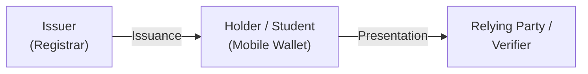

# Problem and Threat Model: Architectural and Cryptographic Flaws in Legacy Academic Credentials

## 1. Executive Summary and Problem Statement

Academic credential systems must balance two competing requirements:
1. **Verifiable Authenticity:** Enabling relying parties (such as employers, background checkers, or academic institutions) to verify the authenticity, integrity, and non-revocation of graduation degrees, transcripts, and GPAs without contacting the issuing university out-of-band.
2. **Selective Disclosure and Privacy:** Empowering graduates to present only relevant claims (for example, demonstrating possession of a Bachelor of Science degree without exposing birth dates, cumulative GPAs, or individual semester grades).

The **IU-VC** (IU-SmartCert) system serves as the primary motivating case study for this project. Although IU-VC was designed to provide verifiable academic credentials using blockchain anchoring and Merkle proofs, an in-depth source code audit of its reference implementation reveals critical architectural, cryptographic, and protocol flaws. 

Most critically, IU-VC's selective disclosure mechanism is **cryptographically insecure and functionally defeated** by its data model. Omitting claims invalidates the outer credential signature, and concealed fields are hashed without random salts, making them vulnerable to offline preimage attacks.

This document establishes the threat model, categorizes legacy failure modes, and outlines the security invariants enforced by UniDipVeri under RFC 9901 and contemporary OpenID specifications.

---

## 2. Threat Model and Attacker Capabilities

In academic credential verification, we analyze four distinct adversary roles:

1. **Curious Relying Party (RP):** A legitimate verifier (e.g., an employer or discount merchant) who legitimately receives a partially disclosed credential, but attempts to infer undisclosed attributes (such as GPA, birth date, or disciplinary records) through offline dictionary, rainbow-table, or brute-force preimage attacks.
2. **Malicious Holder:** A credential subject who attempts to tamper with disclosed values, forge unearned credentials, swap disclosures across different credentials, or present revoked credentials.
3. **Eavesdropping Observer (Network Adversary):** An attacker intercepting presentation payloads on the wire who attempts to link presentations across multiple relying parties or reconstruct the subject's academic history.
4. **Untrusted Intermediate Verifier:** An intermediary in a multi-tenant verification service who inspects payloads outside the relying party's trust perimeter.

---

## 3. Dissection of Legacy Failure Modes (IU-VC Case Study)

### Flaw 1: Coarse Document-Level Anchoring & Vulnerability of Naive Unsalted Claims

- **Legacy Mechanism:** IU-VC anchored entire document components (`degreeCertificate`, `academicTranscript`, `recruiterSubmissionPaper`) into a Merkle tree (`leaf = credentialId || componentType || content`), where `content` was the complete text or payload of the whole document. Because IU-VC operated exclusively at the coarse document level, it provided zero fine-grained field-level selective disclosure: a holder could only disclose or withhold entire documents, but could not redact sensitive attributes (such as GPA or birthdate) from within an academic paper.
- **Attack Vulnerability on Attribute Disclosure:** If an implementer attempts to extend document-anchored Merkle systems to field-level selective disclosure without cryptographically secure random salts, low-entropy attributes (e.g., cumulative GPA between 2.00 and 4.00 at 0.01 increments, birth year within a graduating cohort, or letter grades from A to F) possess virtually zero entropy (< 16 bits). An adversary observing an unsalted hash digest of a concealed attribute can precompute all possible candidate hashes in less than a millisecond, completely uncovering the concealed field.
- **UniDipVeri Invariant:** Under RFC 9901, UniDipVeri implements fine-grained, field-level selective disclosure natively. Every selectively disclosable claim is paired with a cryptographically secure random salt generated by a CSPRNG with at least 128 bits of entropy. The disclosure digest is computed over the base64url-encoded string `[salt, claimName, claimValue]`, rendering offline dictionary and rainbow-table precomputation attacks computationally infeasible (2¹²⁸ search space).

### Flaw 2: Outer Signature Invalidation on Field Omission

- **Legacy Mechanism:** IU-VC wraps the entire credential object within a single W3C JSON-LD credential signature. The digital signature covers the complete stringified payload.
- **Attack Vulnerability:** If a student attempts to redact an attribute before sending the credential to an employer, the payload changes. The signature verification algorithm fails immediately because the digital signature was calculated over the complete document. In IU-VC, "selective disclosure" is only possible if the verifier receives the raw values anyway to recompute the root, or if the verifier participates in a custom Merkle proof protocol that strips outer signature validation.
- **UniDipVeri Invariant:** Under `draft-ietf-oauth-sd-jwt-vc-19` and RFC 9901, the issuer signs a JSON Web Token whose payload contains salted disclosure digests (`_sd` array) rather than plain values. The outer JWS signature remains cryptographically valid regardless of which disclosures the holder reveals or withholds.

### Flaw 3: Ad-Hoc Canonicalization (`stableStringify`)

- **Legacy Mechanism:** IU-VC relies on a custom JavaScript function (`stableStringify`) that sorts object keys recursively using default JavaScript string sorting.
- **Attack Vulnerability:** Hand-rolled serializers suffer from whitespace ambiguity, Unicode normalization discrepancies, number formatting divergence (e.g., `4.0` vs `4`), and floating point round-trip errors. Any cross-platform difference between a Python, Go, or Java verifier produces different SHA-256 digests, leading to false verification rejections.
- **UniDipVeri Invariant:** RFC 9901 eliminates canonicalization dependencies at verification time. Verifiers never re-serialize JSON data to verify digests; instead, the digest is computed directly over the exact US-ASCII bytes of the received base64url disclosure string.

### Flaw 4: Stubbed-Out Key Resolution (`did:web`)

- **Legacy Mechanism:** The IU-VC verifier service contains a `did:web` resolution module that was left incomplete in production, containing a hardcoded `return true` that skips public key dereferencing and outer signature validation.
- **Attack Vulnerability:** Any attacker can construct an arbitrary payload, sign it with an ephemeral untrusted private key, and pass verification.
- **UniDipVeri Invariant:** UniDipVeri implements a strict W3C DID resolver (`packages/core/src/did/did-resolver.ts`) that dereferences `did:web` identifiers over secure HTTPS, validates DID Document schemas, extracts matching `verificationMethod` keys, and strictly validates outer JWS signatures.

### Flaw 5: Synchronous Smart Contract Latency and Availability Bottlenecks

- **Legacy Mechanism:** IU-VC anchors credential status on the Ethereum Sepolia blockchain. Verification requires synchronous JSON-RPC calls to an Ethereum node to query contract state.
- **Attack Vulnerability:** Public blockchain RPC nodes frequently rate-limit, experience block latency (12–15 seconds per block), or fail entirely. Verifiers are forced to either block incoming requests for multiple seconds or bypass revocation checks.
- **UniDipVeri Invariant:** UniDipVeri adopts the IETF Token Status List specification (`draft-ietf-oauth-status-list-21`). Revocation state is published as an HTTP-cacheable, digitally signed, RFC 1950 ZLIB-compressed bitstring. Verifiers check revocation in sub-millisecond in-memory bit-lookups.

### Flaw 6: Synchronous Verification Webhooks and Verifier Coupling (The "Phone-Home" Anti-Pattern)

- **Legacy Mechanism:** In IU-VC, generic W3C envelope checks were performed by an external container, which then triggered a synchronous, unauthenticated HTTP webhook back to the university's internal backend to verify custom Merkle tree proofs and query Ethereum smart contracts.
- **Architectural Anti-Pattern:** While webhooks are a standard industry pattern for *asynchronous enterprise event notifications* (such as notifying an applicant tracking system after verification), placing an issuer webhook *synchronously on the critical path of verification* introduces critical failure modes in decentralized identity:
  1. **Phone-Home Privacy Violation:** Every time a graduate presents a credential to an employer, a synchronous callback hits the university, leaking when and where the student is applying for jobs and defeating presentation unlinkability.
  2. **Temporal and Availability Coupling:** If the issuing university's webhook endpoint experiences downtime or high latency, independent relying parties worldwide cannot verify credentials.
  3. **Loss of Verifier Autonomy:** Relying parties cannot verify credentials using standard off-the-shelf software; they are forced to integrate proprietary, university-specific webhook listeners.
- **UniDipVeri Invariant and Migration Assumption:** UniDipVeri assumes a **clean-slate, standards-native verifiable credential model**. Credentials are self-contained SD-JWT VCs (`dc+sd-jwt`) whose authenticity and revocation status can be verified autonomously by any standard OID4VP verifier (`walt.id`, Sphereon, etc.) without calling back into university servers.
- **Institutional Integration Scope Boundary:** This project does not assume a forced "big-bang" migration of legacy student databases. While enterprise deployments would typically bridge existing Student Information Systems (SIS) to the issuer via message queues or webhooks, the current `apps/issuer` is a standalone reference implementation that exposes direct REST endpoints (`POST /credential-offer`) and an interactive registrar portal, without built-in inbound SIS webhook adapters. Legacy institutional workflows (such as verifying traditional signed PDFs) remain independent, parallel channels.

---

## 4. Summary of Architectural Contrasts

| Dimension | Legacy System (IU-VC) | UniDipVeri Specification |
| :--- | :--- | :--- |
| **Selective Disclosure Granularity** | Coarse document-level (whole PDF/paper components only) | **Fine-grained field-level (RFC 9901)** |
| **Credential Profile** | Non-standard W3C JSON-LD with external Merkle receipt | **`draft-ietf-oauth-sd-jwt-vc-19` (`typ: dc+sd-jwt`)** |
| **Attribute Salting Security** | N/A (no field disclosure; naive baseline unsalted) | **≥ 128 bits CSPRNG salt per claim** |
| **Digest Computation Target** | `stableStringify(value)` JSON text | **US-ASCII bytes of Base64URL disclosure string** |
| **Verification Autonomy** | Fragile two-phase webhook + walt.id | **Unified, autonomous reference engine** |
| **Issuance Protocol** | Custom REST API | **OpenID4VCI 1.0 Final** |
| **Query Protocol** | Proprietary webhook format | **OpenID4VP 1.0 Final with DCQL** |
| **Revocation Mechanism** | Ethereum Sepolia smart contract calls | **IETF Token Status List (`application/statuslist+jwt`)** |
| **Cryptographic Agility** | Fixed single algorithm | **Agile (`ES256`, `EdDSA`, `ES384`) via `jose`** |
