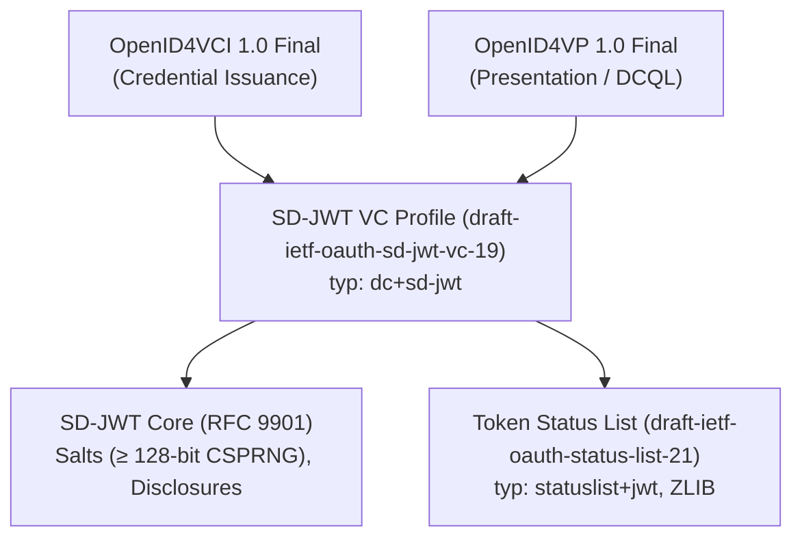

# Standards Profile: Normative Constraints and Ecosystem Profiles

## 1. Overview

To guarantee complete interoperability with off-the-shelf digital wallets (e.g., Paradym, Sphereon, Lissi) and independent third-party verifiers (e.g., Walt.id, SUNET), UniDipVeri strictly adheres to open international standards.

This document profiles the normative requirements and profile constraints adopted by UniDipVeri across cryptographic primitives, credential issuance, presentation exchange, and revocation.

---

## 2. Standard Specifications Profile



### 2.1 SD-JWT Core (RFC 9901)

- **Normative Status:** Published as RFC 9901 in November 2025.
- **Salt Requirements:** Issuers MUST generate salts using a cryptographically secure pseudorandom number generator (CSPRNG) with at least 128 bits of entropy. Verifiers MUST accept any non-empty string as a valid salt.
- **Disclosure Serialization:** Disclosures are serialized as a JSON array of `[salt, claimName, claimValue]` for object claims, or `[salt, claimValue]` for array elements, base64url-encoded without padding.
- **Digest Calculation:** Disclosure digests MUST be calculated over the exact US-ASCII bytes of the received base64url disclosure string. Verifiers MUST NOT decode and re-serialize the JSON disclosure before hashing.
- **Hash Algorithm Agility:** Supported hash algorithms are `sha-256`, `sha-384`, and `sha-512`, signaled via the `_sd_alg` header or payload claim.

### 2.2 SD-JWT Verifiable Credential Profile (`draft-ietf-oauth-sd-jwt-vc-19`)

- **Normative Status:** Active Internet-Draft (intended Proposed Standard).
- **Media Type & JWS Header:** Credential `typ` header parameter is `"dc+sd-jwt"` (Draft 19 updated media type from earlier `vc+sd-jwt`). UniDipVeri also supports legacy `vc+sd-jwt` in backwards-compatibility mode for older wallet clients.
- **VCT (Verifiable Credential Type):** Credential payload MUST include a `vct` claim referencing an absolute HTTPS URI or institutional type identifier (e.g., `https://issuer.university.edu/types/graduation-record/v1`).
- **Holder Key Binding (CNF):** When key binding is enabled, the credential MUST include a `cnf` claim containing the holder's public key (`cnf.jwk`). Holder presentations append an ephemeral Key Binding JWT (`typ: "kb+jwt"`) signed by the holder's private key, containing `aud`, `nonce`, and `sd_hash` (hash of the SD-JWT plus present disclosures).

### 2.3 OpenID for Verifiable Credential Issuance (OpenID4VCI 1.0 Final)

- **Normative Status:** Approved Final OpenID specification.
- **Credential Issuer Discovery:** Published at `/.well-known/openid-credential-issuer`, declaring supported credentials, cryptographic algorithms, display values, and endpoints.
- **Authorization Flow:** Supports Pre-Authorized Code Flow. The issuer generates a credential offer (`openid-credential-offer://`) containing an ephemeral pre-authorized code, transaction PIN challenge, and credential configuration identifier.
- **Token Endpoint:** Standard OAuth 2.0 Token endpoint with single-use authorization code burning, timing-safe PIN verification, and issuance of ephemeral DPoP-bound tokens and `c_nonce`.
- **Proof-of-Possession:** Holders submit a signed proof-of-possession JWT bound to the issuer's `c_nonce` and `aud`.

### 2.4 OpenID for Verifiable Presentations (OpenID4VP 1.0 Final) and DCQL

- **Normative Status:** Approved Final OpenID specification.
- **Query Language:** Digital Credentials Query Language (DCQL) is the sole query language, replacing DIF Presentation Exchange (`presentation_definition`, `limit_disclosure`).
- **DCQL Query Structure:** Verifier requests specific claims as an array of path segments under a typed credential identifier:
  ```json
  {
    "credentials": [
      {
        "id": "diploma_credential",
        "format": "dc+sd-jwt",
        "meta": {
          "vct_values": ["https://issuer.university.edu/types/graduation-record/v1"]
        },
        "claims": [
          { "path": ["papers", "diploma", "degreeName"] },
          { "path": ["studentId"] }
        ]
      }
    ]
  }
  ```
- **Response Format:** Submissions are returned in the authorization response payload containing matching SD-JWT tokens and filtered disclosures.
- **Query Expressiveness & Array Filtering Limitations:** DCQL specifies claim requirements strictly through static path arrays (e.g. `["papers", "diploma", "degreeName"]`). Unlike SQL or relational query languages, DCQL cannot query into arrays of objects using conditional predicate selectors (for example, expressing `SELECT grade FROM courses WHERE code = "CS101"`). Furthermore, value matching in DCQL only evaluates exact equality; it does not support regex pattern matching or substring filtering (such as matching `"Database"` against `"Database Systems"` when querying a course title). Applications requiring conditional array item inspection or fuzzy pattern validation must disclose the containing array structure and evaluate attributes post-presentation within Relying Party policy logic.

### 2.5 Interoperability Scope and HAIP Non-Conformance (Explicit Boundary)

- **No HAIP Conformance Claim:** UniDipVeri does **not** claim conformance with the OpenID4VC High Assurance Interoperability Profile (HAIP 1.0) or with any official conformance test suite.
- **Pre-Authorized Code Scope:** UniDipVeri implements solely the Pre-Authorized Code flow of OpenID4VCI 1.0 Final. The Authorization Code flow is not implemented.
- **Excluded HAIP Mechanisms:** Mechanisms mandated or profiled by HAIP—including Pushed Authorization Requests (PAR / RFC 9126), PKCE (RFC 7636), Demonstrating Proof of Possession (DPoP / RFC 9449), and Wallet Attestation—are intentionally out of scope.
- **Wallet Compatibility Boundary:** Commercial digital wallets that require strict HAIP conformance or demand Authorization Code flow with PAR/PKCE/DPoP will not interoperate with this issuer, as documented in the root project limitations.

### 2.6 Token Status List Revocation (`draft-ietf-oauth-status-list-21`)

- **Normative Status:** Active IETF Internet-Draft.
- **Data Model:** Credential payload references revocation status via the `status` claim:
  ```json
  {
    "status": {
      "status_list": {
        "idx": 42,
        "uri": "https://issuer.university.edu/status/academic-2026"
      }
    }
  }
  ```
- **Status List Document:** Served as a signed JWT (`application/statuslist+jwt`) containing a compressed bitstring using RFC 1950 ZLIB compression. Cache duration is configurable via the `ttl` claim and HTTP `Cache-Control: max-age` header (default 300 seconds). When caching is disabled (`ttl: 0`, serving `no-cache, no-store, must-revalidate`), the `exp` claim is omitted to prevent immediate expiration while ensuring instant revocation propagation.
- **Revocation Lookup:** Verifiers decompress the bitstring and check the bit value at `status_list.idx` (0 = active/valid, 1 = revoked).

---

## 3. Summary of Normative Invariants

1. **Strict Base64URL Digest Rule:** Verifiers hash the exact US-ASCII bytes of the received disclosure string; no JSON canonicalization or stringification is applied at verification time.
2. **Entropy Gate:** Salts generated by the issuer have a minimum of 128 bits of CSPRNG entropy.
3. **No Reserved Names in Schema:** Claim definitions cannot use reserved SD-JWT keys (`_sd`, `...`, `_sd_alg`).
4. **Autonomous Key Dereferencing:** Verifiers autonomously resolve issuer public keys using W3C `did:web` and DID Document schemas without relying on pre-shared keys.
