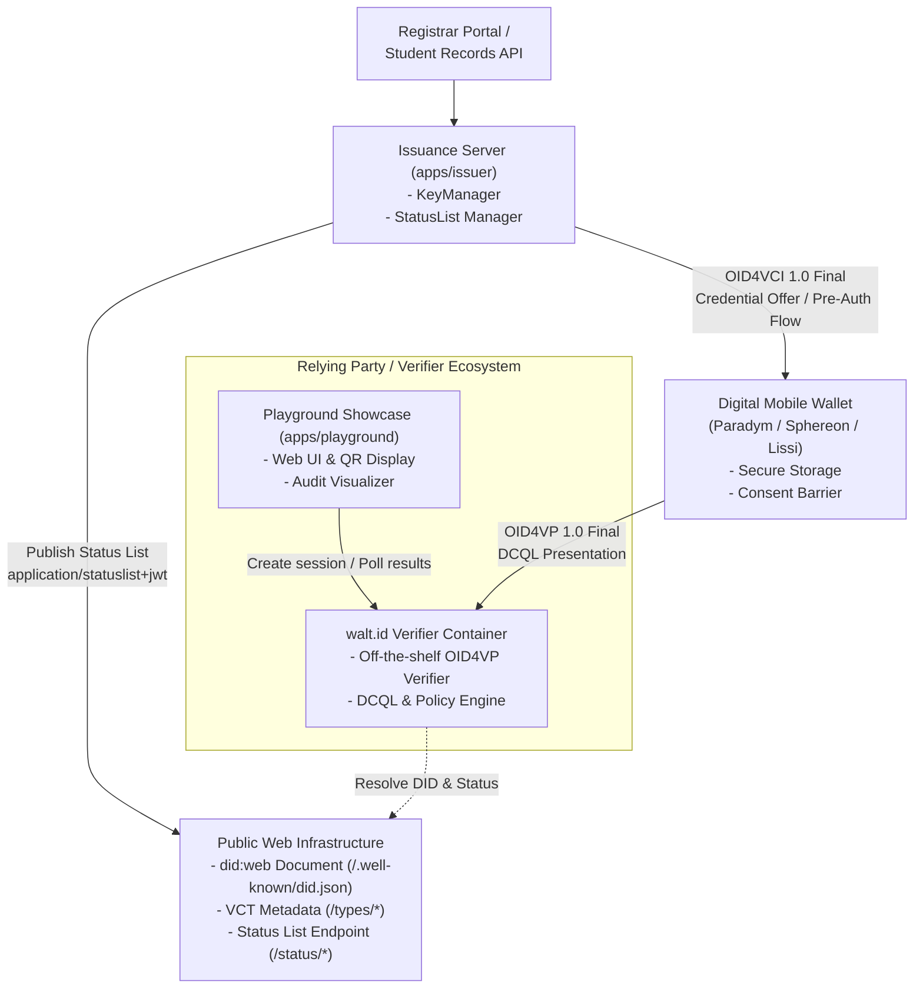
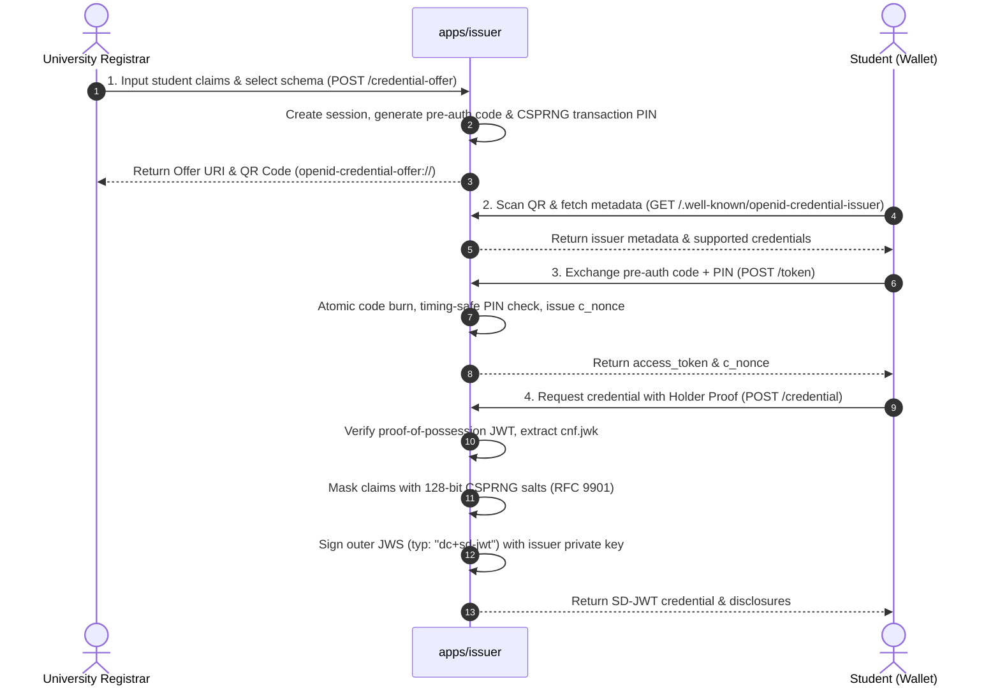
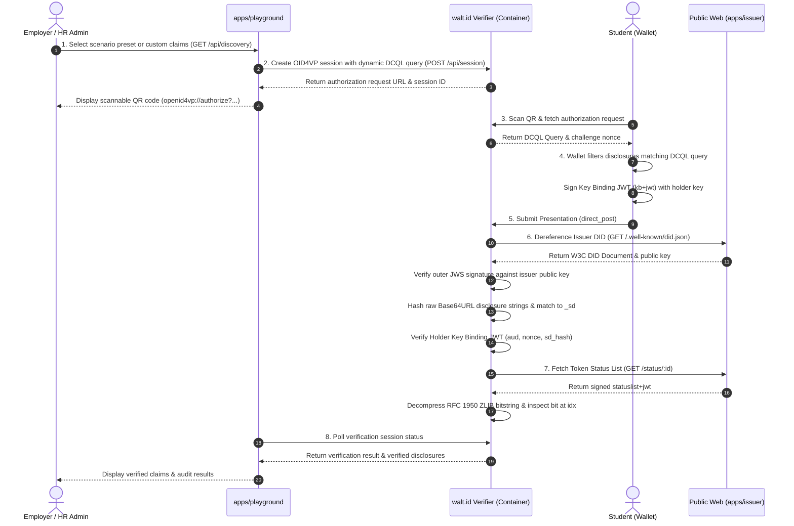
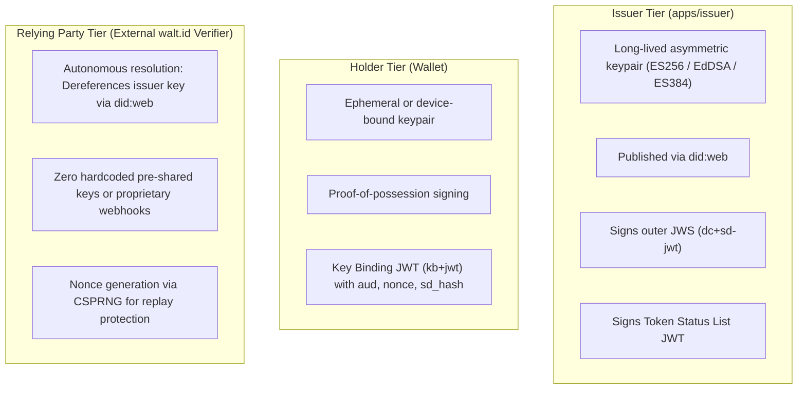

# System Architecture: End-to-End Dataflow, Key Management, and Security Boundaries

## 1. System Overview

UniDipVeri implements a full-lifecycle verifiable credential architecture consisting of three operational roles:
1. **Issuer Application (`apps/issuer`):** An OpenID4VCI 1.0 Final server providing an interactive registrar portal, pre-authorized code session management, direct REST offer issuance (`POST /credential-offer`), cryptographic credential issuance (`typ: "dc+sd-jwt"`), W3C `did:web` publishing, and Token Status List revocation. Inbound SIS webhook integration adapters are deliberately decoupled from this reference prototype, operating as a future enterprise ingestion boundary.
2. **Core SD-JWT VC Engine (`packages/core`):** A schema-agnostic TypeScript library providing RFC 9901 salting and recursive claim masking, JWS signing, and W3C `did:web` identifier resolution.
3. **External Relying Party / Verifier (`walt.id` Verifier) & Playground Showcase (`apps/playground`):** Credential verification is not performed by a university-operated verifier backend; it is delegated to independent, off-the-shelf relying party verifiers (specifically, the `walt.id` verifier container) using OpenID4VP 1.0 Final and DCQL. A verifier demonstration showcase (`apps/playground`) provides a human-readable web UI that initiates verification sessions against the `walt.id` verifier, presents scannable QR codes to mobile wallets, and displays verified claim disclosures and audit results.

---

## 2. End-to-End Issuance Protocol Flow (OpenID4VCI 1.0 Final)

Credential issuance follows the Pre-Authorized Code Flow:

### Key Security Invariants in Issuance

1. **Atomic Code Burning:** Pre-authorized codes are stored with single-use atomic consumption semantics. A second presentation of the same authorization code immediately fails, preventing replay attacks.
2. **Timing-Safe PIN Verification:** The student transaction PIN is checked using constant-time comparison (`crypto.timingSafeEqual`) to prevent timing side-channel attacks.
3. **Holder Key Binding Extraction:** The holder's Proof-of-Possession JWT must be bound to the issuer's issued `c_nonce`. The extracted JWK is sanitized and embedded in the credential's `cnf.jwk` claim.
4. **128-Bit CSPRNG Entropy:** Every selectively disclosable claim receives a uniquely generated salt with a minimum of 16 cryptographically random bytes.

---

## 3. End-to-End Verification Protocol Flow (OpenID4VP 1.0 Final & DCQL)

Presentation and verification follow the DCQL query lifecycle with the external `walt.id` verifier:

---

## 4. Key Management and Cryptographic Boundaries

1. **Algorithm Agility:** Private keys can be configured as ECDSA with curve P-256 (`ES256`), Ed25519 (`EdDSA`), or ECDSA with curve P-384 (`ES384`). The key generator utility (`scripts/generate-key.ts`, run via `bun run keygen`) creates and formats exportable JWK keypairs matching all supported curves.
2. **DID Web Resolution:** The relying party verifier (`walt.id`) dereferences `did:web:issuer.university.edu` by requesting `https://issuer.university.edu/.well-known/did.json`, parsing the DID Document, and resolving the cryptographic public key from the matching `verificationMethod.publicKeyJwk`.
3. **Revocation Independence:** Revocation verification does not require contacting a live transaction gateway or blockchain node; status is determined from the signed, compressed status list bitstring.
