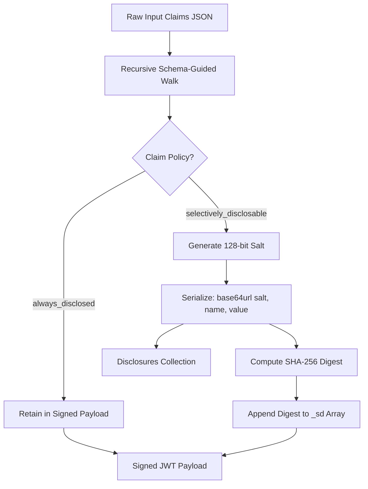

# Schema and Data Model: Declarative Configuration, Validation, and Claim Masking

## 1. Architectural Principle: Schema Independence

A foundational design principle of UniDipVeri is the strict separation between the SD-JWT VC engine and domain-specific credential definitions:

> No package in `packages/core` may infer the location of credential schemas from its own filesystem position or the process working directory. Schema artifacts are supplied explicitly by the application or deployment environment.

`packages/core` contains zero hardcoded university fields. All schema definitions reside outside the engine in declarative YAML configuration files (such as [`schemas/graduation-record.v1.yaml`](../../schemas/graduation-record.v1.yaml)), making the system reusable across diverse educational, professional, and civic credential ecosystems.

---

## 2. Declarative Schema Structure

Credential schemas are defined in YAML. Every field in the schema explicitly declares its data type, requirement flag, and selective disclosure policy (`sd`):

```yaml
vctPath: "/types/graduation-record/v1"
name: "Graduation Academic Record"
description: "Official comprehensive graduation credential for academic degrees and coursework."

claims:
  studentId:
    type: string
    required: true
    sd: always_disclosed       # Visible in plain payload
  dateOfBirth:
    type: string
    format: date
    required: false
    sd: selectively_disclosable # Masked behind _sd digest
  papers:
    type: object
    required: true
    sd: always_disclosed
    properties:
      diploma:
        type: object
        sd: selectively_disclosable
        properties:
          degreeName:
            type: string
            sd: always_disclosed
          graduationDate:
            type: string
            sd: always_disclosed
      transcript:
        type: object
        sd: selectively_disclosable
        properties:
          cumulativeGPA:
            type: number
            sd: selectively_disclosable
          totalCreditsEarned:
            type: number
            sd: always_disclosed
```

### Selective Disclosure Policy Options

1. **`always_disclosed`:** The claim key and value are embedded directly in the cleartext payload of the signed JWT. They are visible to any entity inspecting the token. Used for non-sensitive identifiers and credential metadata (e.g., `studentId`, `degreeName`).
2. **`selectively_disclosable`:** The claim is stripped from the cleartext payload, assigned a random 128-bit CSPRNG salt, encoded into a standalone disclosure string, and replaced in the signed payload by a SHA-256 digest in the `_sd` array. The holder decides whether to present this disclosure to verifiers.

---

## 3. Strict Zod Boundary Validation

To eliminate silent configuration errors, schema definitions are validated at startup using Zod schemas in [`packages/core/src/schema/validator.ts`](../../packages/core/src/schema/validator.ts):

- **Strict Path Format:** `vctPath` must be a valid RFC 3986 path starting with `/`.
- **Exhaustive Policy Assignment:** Every named claim (both root-level and nested within objects) MUST define an explicit `sd` property. Missing policies cause immediate validation errors.
- **Structural Completeness:** Objects must declare a non-empty `properties` dictionary; arrays must declare an `items` specification.
- **Reserved Name Protection:** Schemas containing reserved SD-JWT claims (`_sd`, `...`, `_sd_alg`) are rejected immediately to prevent namespace collisions.
- **No Unknown Keys:** Schema validation uses `.strict()` mode to reject unknown properties.

---

## 4. Recursive Claim Masking Pipeline (RFC 9901)

The claim transformation engine in [`packages/core/src/sd-jwt/transform.ts`](../../packages/core/src/sd-jwt/transform.ts) implements the recursive masking algorithm specified by RFC 9901:



### Claim Transformation Rules

1. **Object Properties:** When an object claim is marked `selectively_disclosable`, its parent object contains an `_sd` array of disclosure digests. The actual key-value pair is removed from the object.
2. **Nested Objects:** When an object itself is `always_disclosed` but contains nested `selectively_disclosable` properties, the container object remains visible, while nested disclosable properties are replaced by an inner `_sd` array within that sub-object.
3. **Array Elements:** When an array element is marked `selectively_disclosable`, it is replaced in the array by an ellipsis digest object: `{"...": "<digest>"}`.
4. **Deterministic Digest Verification:** Digests in `_sd` arrays are computed strictly over the raw Base64URL disclosure string, guaranteeing cross-platform verification reproducibility across diverse language runtimes.
