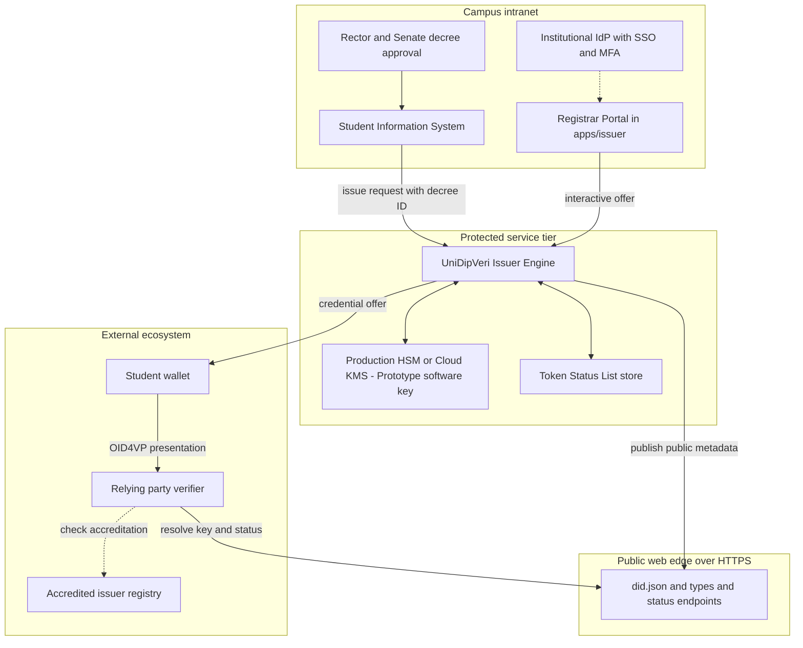
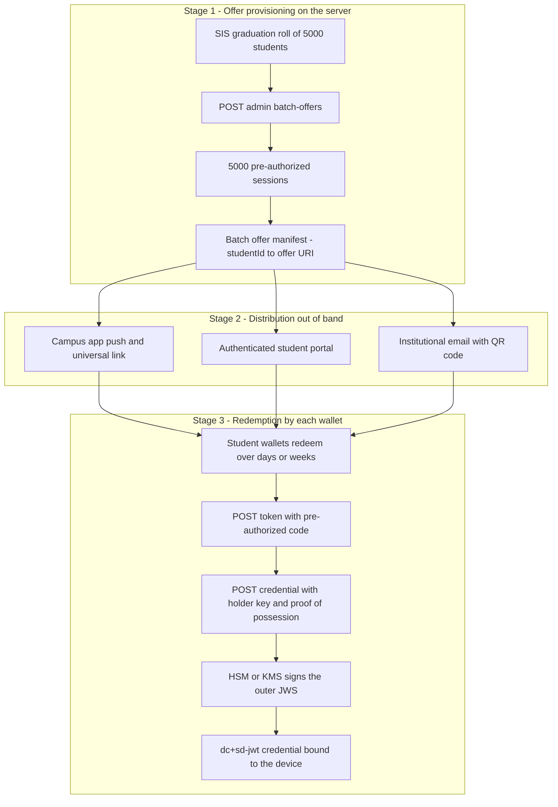
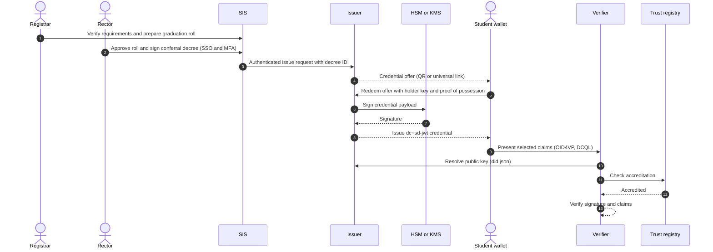

# Operations and Governance: Deployment, Key Custody and Trust Architecture

## 1. Overview

When a university evaluates a Verifiable Credential system, the cryptographic primitives (SD-JWT VC per RFC 9901, outer JWS signatures, Token Status Lists) are only one layer. Institutions also need answers to two governance questions:

1. **Operational accessibility:** how non-technical staff (registrar clerks, academic affairs officers) operate the system without cryptographic or command-line skills.
2. **Authority and key custody:** how the system ensures credentials carry the legal authority of the university, and why credentials minted by internal developers or IT staff fail verification at external relying parties.

### Terminology used throughout

- **Rector:** the head of the institution. Equivalent titles (Principal, Chancellor, Vice-Chancellor, President) all map to this role. The Rector, with the Academic Senate, is the **Authorizer**: they sign the conferral decree.
- **Registrar:** the Registrar's Office is the **Maker**: it audits requirements, prepares the graduation roll, and issues credentials only for students covered by an approved decree.
- **Key custodians:** the designated trustees (for example the CIO, the Registrar and Legal Counsel) who hold the quorum for key generation and rotation.
- **Prototype** means what is implemented in this repository today. **Production** means the target enterprise deployment.

### Scope: reference prototype vs. target production architecture

- **Reference prototype (`apps/issuer`, `packages/core`):** a self-contained demonstrator running on Bun with no cloud dependencies. It implements the cryptographic core, declarative schema-driven claim forms, OID4VCI 1.0 Final endpoints and Token Status List revocation. It uses a software JWK and in-memory repositories so evaluators can run and benchmark the full lifecycle locally.
- **Target production architecture:** the deployment model for university IT: Hardware Security Modules (FIPS 140-2 Level 3), institutional single sign-on (SAML 2.0 or OpenID Connect), Student Information System (SIS) connectors (Banner, PeopleSoft, Workday), and enrollment in accredited trust registries.

[Section 8](#8-gap-analysis-reference-prototype-vs-enterprise-production) gives the gap analysis between the two.

---

## 2. Deployment Topology and Personas

Production operates across three trust tiers plus the external ecosystem. The prototype packages the protocol logic into one runtime.



Production-only components: SIS, institutional IdP, decree approval, HSM/KMS and the accredited registry. Implemented in the prototype: the portal, issuer engine, software key, status list store and the public endpoints.

### Personas and responsibilities

| Persona | Role in issuance | Interface | Signing-key access | Must not be able to |
| :-- | :-- | :-- | :-- | :-- |
| **Rector** | **Authorizer.** Signs the conferral decree for each graduating cohort. Is the legal authority behind the institutional identifier (`did:web`). | SIS decree approval (SSO + MFA) | None. Authority is exercised through the decree, not through key access. | Issue credentials directly, or access or export keys. |
| **Registrar** | **Maker.** Prepares the graduation roll and issues credentials only for students covered by an approved decree. Also handles lifecycle cases: wallet re-issuance, interim transcripts, and executing revocations authorized under a documented case reference. | SIS and Registrar Portal | None | Create a degree without an approved decree, or edit degree claims in production. |
| **Key custodians** (CIO, Registrar, Legal Counsel) | Hold the quorum for key generation and rotation ceremonies. | HSM / KMS ceremony | Quorum-controlled | Act alone, or export keys. |
| **DevOps / IT administration** | Operate the deployment: containers, networking, TLS certificates, backups. | Infrastructure as Code, deployment pipelines | None | Invoke the KMS `Sign` API or access production keys. |
| **Software developers** | Build and test schemas, claim mappings and integrations. | Local environment, git repository | Development test keys only | Access production KMS or sign production credentials. |
| **Student / graduate** | Receives the credential and chooses what to disclose. | Mobile wallet | Holder key (`cnf.jwk`) in the device's secure hardware | Alter issued claims. |
| **Relying party / employer** | Requests claims and verifies the signature and issuer accreditation. | OID4VP verifier, applicant tracking system | None (public keys and trust-registry lookups only) | Learn undisclosed claims. |

*Separation of duties, HSM custody and SIS-bound issuance apply to production. The prototype uses a software key and an open portal so it can be evaluated locally.*

---

## 3. Non-Technical Staff Workflow

A common misconception is that operating a credential issuer requires staff to understand JSON Web Signatures, Base64URL encoding or hashes. UniDipVeri avoids this with two layers.

### 3.1 Layer 1: the turnkey Registrar Portal (prototype)

The portal (`apps/issuer/src/routes/portal.ts`) is served at `/` and `/issue`:

1. **Schema adaptation.** When a schema such as `schemas/graduation-record.v1.yaml` is loaded, the portal reads the claim definitions and generates form controls (text fields, date pickers, numeric inputs, dynamic course tables).
2. **Privacy badges.** Each field is badged **Always Disclosed** (in the clear) or **Selectively Disclosable** (salted and hidden behind `_sd` digests), so staff can see the privacy policy at a glance.
3. **One-click offer.** The clerk selects a pre-seeded student record, reviews the summary, and clicks **Issue Credential Offer**.
4. **QR generation.** The portal renders an `openid-credential-offer://` URI as a QR code for in-person scanning, or the offer can be sent through authenticated student email.

Clerks never write code, run curl commands or handle keys.

### 3.2 Governance gate: why the Registrar cannot bypass the Rector

> *If registrar staff can use the portal, and the portal creates offers that the issuer signs, can a clerk bypass the Rector's approval and mint degrees unilaterally?*

It depends on the deployment:

1. **In the prototype, the portal is deliberately open.** Evaluators can edit claim fields to see how schemas render and how selective disclosure works. It omits role-based authorization because that would require an external university hierarchy.
2. **In production, two safeguards enforce separation of duties:**
   - **No free-form degree claims.** The portal runs in read-only binding mode. Clerks can search and select only students whose status is `CONFERRED` under a signed decree in the SIS. They cannot type degree names, majors or grades.
   - **Maker-Authorizer control.** The Registrar's Office (Maker) audits requirements and prepares the graduation roll. The Academic Senate and the Rector (Authorizer) sign the conferral decree. The issuer rejects any offer request without a valid, active decree identifier with `403 Forbidden`.

### 3.3 Layer 2: headless SIS integration (production)

Large universities should not have to retrain staff on a new interface. They already run an SIS such as Ellucian Banner, Oracle PeopleSoft Campus Solutions or Workday Student.

1. **No retraining.** Registrar staff keep working in their familiar SIS screens.
2. **Event-driven trigger.** When the Rector approves the conferral decree, the SIS marks the cohort `CONFERRED`.
3. **Headless API call.** The SIS sends an authenticated REST request (`POST /credential-offer`, or `POST /admin/batch-offers` for a whole cohort) to the issuer, with the decree identifier and student records.
4. **Dual-track delivery.** The SIS continues producing signed PDFs for legacy email workflows while the issuer dispatches SD-JWT credential offers to student wallets.

### 3.4 Headless issuance vs. Registrar-managed lifecycle

> *If the electronic decree can trigger issuance automatically, why does the university still need a Registrar portal?*

Because scheduled graduation and day-to-day credential lifecycle are different workloads. In production, the headless path handles most graduation issuance, and the portal handles the cases below. Each action is authorized separately and written to the audit log.

| Scenario | Path | Authorization |
| :-- | :-- | :-- |
| Standard graduation cohort | Headless: SIS to issuer after decree approval | Rector's conferral decree |
| Wallet loss or device replacement | Registrar Portal: verify identity, retrieve archived conferral record, issue a fresh offer. Revoke the old credential's status entry so the lost device's copy stops verifying. | No new decree needed (degree already conferred); identity check recorded |
| Revocation (misconduct, administrative error) | Registrar Portal executes `/admin/revoke` | Decided by the Rector or the designated disciplinary body; case reference required. The Registrar executes but does not decide. |
| Interim credentials (transcripts, GPA certificates, enrollment verification) | Registrar Portal, with read-only binding to current SIS records | Institutional records policy; no graduation decree applies |
| Campuses without integration-ready systems (legacy ERPs, SQL databases) | Turnkey portal as the zero-integration path | Local policy, plus the controls above where configured |

---

## 4. Mass Issuance: Solving the OpenID4VCI Holder-Binding Paradox

> *How does the university issue credentials to 5,000 graduating students at once? Can the server sign 5,000 credentials in a batch script?*

### 4.1 Why batch pre-signing is not possible

In paper or document-PKI workflows, mass issuance is an offline loop: generate 5,000 files, sign them, send them. In OpenID4VCI with SD-JWT VC this does not work, by design:

1. **Holder key binding (`cnf.jwk`).** The signed payload must bind the public key generated inside the secure hardware of the student's phone.
2. **Bearer-token risk.** Credentials pre-signed without holder keys would be unbound bearer tokens. Anyone who intercepted one could present it.
3. **Consequence.** The outer JWS cannot be produced until the student's wallet connects, presents its public key and proves possession of the private key.

Mass issuance is therefore a two-phase process: **mass pre-authorized offer provisioning**, then **distributed asynchronous wallet redemption**.



### 4.2 The four-stage pipeline (production)

1. **Cohort ingestion and offer generation.** After the Rector signs the decree, the SIS sends the approved cohort to `POST /admin/batch-offers`. The issuer creates one pre-authorized session per student, each holding a CSPRNG `pre-authorized_code`, an optional transaction PIN (`tx_code`) for out-of-band verification, and pre-computed salted claim disclosures. It returns a manifest mapping each `studentId` to its `credential_offer_uri`.
2. **Out-of-band distribution.** Thousands of students do not scan one screen. Offers go out through the campus app (push notification and universal link), the SSO-protected student portal (an **Add Diploma to Digital Wallet** button), or personalized institutional email with a one-time QR code and link.
3. **Distributed redemption.** Over days or weeks, each wallet calls `POST /token` with its `pre-authorized_code`, then `POST /credential` with its holder key and proof of possession. Because disclosures were pre-computed, the issuer only performs the final outer JWS signature.
4. **Bundling and deferred flows.** A wallet receiving several documents at once (diploma, transcript, honours certificate) uses `POST /batch_credential` to get them in one round trip. If the HSM or KMS enforces tight rate limits, the issuer returns `202 Accepted` with a `transaction_id` through the deferred flow and the wallet polls `POST /deferred_credential`.

**Performance note.** In the prototype's benchmarks, with a software key, outer JWS signing takes about 0.5 ms (roughly 1,930 operations per second for EdDSA and 1,460 for ES256). Throughput with an HSM or Cloud KMS depends on the provider and its quotas, which is why the deferred flow exists.

---

## 5. The Rector's Authority: Paper Conferral vs. Cryptographic Issuance

> *On paper, the Rector signs the diploma and the university applies its seal. Does the Rector sign the digital credential? How do we ensure only authorized credentials are recognized, while credentials minted by internal developers fail?*

### 5.1 Issuance flow

The Registrar verifies requirements first, then the Rector approves. The credential is signed only when the student's wallet redeems the offer (Section 4).



### 5.2 Institutional seal and conferral decree

- **Institutional digital seal.** A paper diploma carries two things: the Rector's signature (the conferral act) and the university's embossed seal (its accreditation). In the digital model, the outer JWS produced with the institution's private key is the seal, and the institution is the issuer (`iss`, for example `did:web:university.edu`). In the prototype this key is a software JWK loaded by `KeyManager`. In production it sits in non-exportable HSM or KMS custody.
- **Conferral decree in the claims.** Issuance is legally predicated on the decree the Rector signs in the SIS. The schema can embed that authority as claims under the issuer signature, for example:

```json
{
  "conferralAuthority": {
    "title": "Rector",
    "name": "Prof. Dr. Jane Doe",
    "decreeNumber": "RECT-2026-4412",
    "conferralDate": "2026-06-15",
    "faculty": "Faculty of Engineering and Technology"
  }
}
```

Institutions that need dual-layer signing (for example an eIDAS qualified electronic seal plus the Rector's qualified electronic signature) can embed the Rector's attestation token as a nested claim.

### 5.3 Paper signing does not trigger issuance

> *Does the Rector physically signing paper diplomas fire a webhook that triggers digital signing?*

No. A pen on paper is a fragile trigger, as it would depend on scanning, OCR or manual tracking. Instead, the **electronic conferral decree** is the common root of trust. Its approval in the SIS forks into two synchronized pipelines:

- **Ceremonial paper pipeline:** the approved roll goes to the print shop. Diplomas are printed, embossed with the physical seal and signed (wet or registered facsimile) for the commencement ceremony.
- **Cryptographic digital pipeline:** the same approval triggers the authenticated request to the issuer, which signs with the institutional key and embeds the decree number and conferral authority in the claims.

The Rector signs **once**, on the master decree, instead of approving thousands of credentials individually, and paper and digital credentials stay in one-to-one correspondence.

---

## 6. Institutional Key Custody and Separation of Duties

In an enterprise deployment, software developers do not have direct access to production signing keys. These controls establish separation of duties and prevent developers or system administrators from independently signing or issuing unauthorized credentials.

1. **Non-exportable key storage.** Production private keys are generated inside FIPS 140-2 Level 3 HSMs or Cloud KMS (AWS KMS, Google Cloud KMS, Azure Key Vault). No engineer can download them as plaintext.
2. **Least privilege.** Developers and DevOps can change repositories and deployment scripts but have no IAM permission to call the KMS `Sign` API.
3. **Key custodian quorum.** Key generation and annual rotation require a multi-party ceremony with the key custodians (for example the CIO, the Registrar and Legal Counsel). No single person can act alone.
4. **Tamper-evident audit logging.** Every signing call is logged (timestamp, calling service account, decree or authorization ID) to a SIEM or equivalent. Anomalous issuance triggers automated alerts.

---

## 7. Trust Frameworks and External Verifier Rejection

Suppose a developer runs a private copy of the issuer, mints an SD-JWT VC with fraudulent claims and presents it to an employer. It is rejected for three independent reasons.

1. **Signature mismatch (`did:web` domain binding).** If the developer sets `iss` to `did:web:university.edu`, the verifier fetches `https://university.edu/.well-known/did.json` and checks the outer JWS against the university's published key. Without the production private key, the check fails.
2. **Trust registry rejection.** If the developer signs with their own key and publishes their own DID (for example `did:web:dev-university.com`), the signature verifies but the issuer is not in the accredited issuer registry (for example an EBSI Trusted Issuers Registry or a national accreditation list), so verifiers that enforce registry checks reject it.
3. **Type metadata isolation.** Production verifiers whitelist the `vct` values they accept (for example `https://university.edu/types/graduation-record/v1`). A credential pointing at a developer's local or staging type endpoint is rejected by the DCQL policy before its claims are parsed.

**Caveats.** Reasons 2 and 3 depend on the verifier's configuration. Reason 1 relies on control of the university's domain and DNS, so those should be protected like the signing key itself.

---

## 8. Gap Analysis: Reference Prototype vs. Enterprise Production

| Dimension | Reference prototype (`apps/issuer`) | Target production | Gap and transition path |
| :-- | :-- | :-- | :-- |
| **Issuance scale** | Single-student issuance through the portal and `POST /credential-offer`. | Cohort ingestion (`POST /admin/batch-offers`), multi-channel universal-link distribution, `POST /batch_credential`, deferred queue. | Credentials cannot be pre-signed without holder keys. Add a batch offer ingestion loop and rely on deep links for distributed redemption. |
| **Key storage** | Software JWK via `KeyManager`, with a startup self-test. | FIPS 140-2 Level 3 HSM or Cloud KMS. | The `Signer` callback in `packages/core` accepts any signing function. Replace the local `jose.SignJWT` call with a KMS call; no protocol routes or SD-JWT code change. |
| **Registrar interface** | Open, schema-driven portal where evaluators can edit test claims. | Existing SIS, or an SSO-protected portal in read-only binding mode against approved cohorts. | Disable free-form editing so the Registrar can issue only for students with an approved decree. |
| **Authentication and access** | Pre-authorized code sessions with CSPRNG entropy, atomic single use and timing-safe PIN checks. | Institutional IdP (SAML 2.0 or OIDC) with MFA and RBAC. | Terminate staff login at an edge proxy or OAuth 2.0 middleware (Cloudflare Access, AWS ALB, NGINX) that injects identity headers. |
| **Academic records** | In-memory repository (`student-records.ts`) seeded with CS and EE examples. | Production SIS database (Oracle, PostgreSQL) or institutional REST/GraphQL API. | Point the async `getStudentRecord(studentId)` boundary at the SIS; issuance routes are unchanged. |
| **Conferral authority** | Schema fields in `schemas/graduation-record.v1.yaml` demonstrate masking and selective disclosure. | Electronic conferral decree approved by the Rector in the SIS, triggering both paper printing and digital issuance. | The Rector signs one decree, and the issuer embeds its number and authority in the claims. |
| **Revocation** | Token Status List engine (`status-list.ts`) serving gzip-compressed `application/statuslist+jwt` per draft-21. | Distributed status list on Redis or clustered PostgreSQL, with SIEM audit streaming. | Replace the in-memory `Uint8Array` bitstring with a persistent store; the engine is already standards-compliant. |
| **Trust registry** | Standalone `did:web` publishing (`/.well-known/did.json`) resolved by standard resolvers and test verifiers (`walt.id`). | National or international registries (EBSI, National Student Clearinghouse). | Verifiers configure registry lookups so the issuer's `did:web` must be listed as an accredited institution. |

---

## 9. Paper Diploma vs. UniDipVeri SD-JWT VC

| Dimension | Paper diploma | UniDipVeri SD-JWT VC | Difference |
| :-- | :-- | :-- | :-- |
| **Conferral authority** | Rector's wet signature; decree filed in paper archives. | Rector's electronic decree sign-off in the SIS; decree number in the signed claims. | Wet signatures can be forged from high-resolution scans; claims are protected by the issuer signature. |
| **Institutional authenticity** | Embossed seal, watermarked paper, microprinting. | Institutional digital seal via `did:web:university.edu`, backed by an HSM in production. | Physical seals can be copied; forging the signature without the private key is computationally infeasible. |
| **Delivery** | Handed over at commencement or sent by registered post. | OpenID4VCI offer redeemed into the student's wallet. | Removes postal loss, damage and reprint administration. |
| **Verification** | Phone or email inquiry to the Registrar; can take weeks. | Automated cryptographic verification through OID4VP. | Removes the manual burden for employers and universities. |
| **Privacy** | All or nothing: a photocopy reveals GPA, student ID and every grade. | RFC 9901 selective disclosure: the student can reveal only the degree name. | Prevents over-disclosure to employers and third parties. |
| **Revocation** | Recall letters; the paper stays with the graduate. | Token Status List check against a published bitstring. | Revocation takes effect without the university seeing where the credential is presented. |

---

## 10. Summary: Operational and Governance Safeguards

| Threat or challenge | Solution | Enforcing mechanism |
| :-- | :-- | :-- |
| Mass cohort (5,000+ students) without manual QR scanning | Two-phase issuance: batch offer ingestion, then multi-channel distribution | SIS sends the approved cohort to the batch endpoint; wallets redeem asynchronously through deep links |
| Non-technical staff issuing credentials | Turnkey Registrar Portal, or headless SIS integration | Schema-driven form (`portal.ts`) and `POST /credential-offer` |
| Rector must authorize conferral | Decree sign-off in the SIS, embedded in the claims | SSO and MFA approval; decree number inside the signed payload |
| Registrar tries to mint an unapproved degree | Maker-Authorizer control | Read-only binding to `CONFERRED` students; `403 Forbidden` without a valid decree ID |
| Developer signs a fraudulent degree with a test key | `did:web` domain binding and trust registry validation | Verifier resolves the key from the official domain and rejects unaccredited issuers |
| Insider with production server access tries to forge | Non-exportable HSM or KMS keys, least privilege and quorum custody | No signing permission for developers or DevOps; every signing call is audited |
| Fields disclosed that should stay private | Schema-enforced selective disclosure | Claims hashed into `_sd` digests; the holder controls disclosure in the wallet |
| Revoked diploma presented after retraction | Token Status List check | Verifier downloads the status bitstring and checks the index locally |
